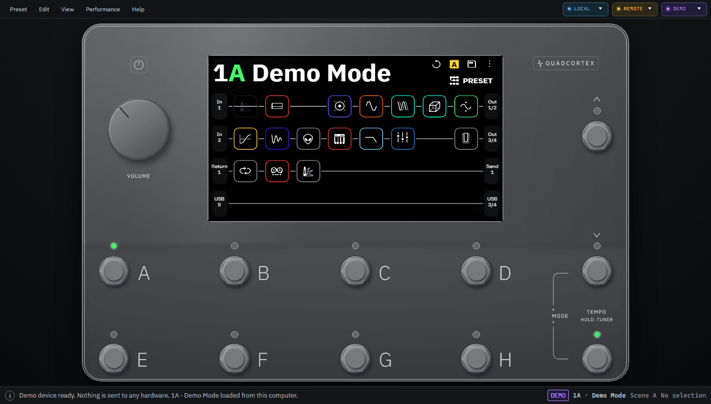
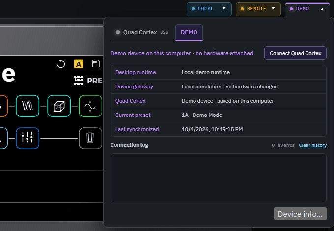
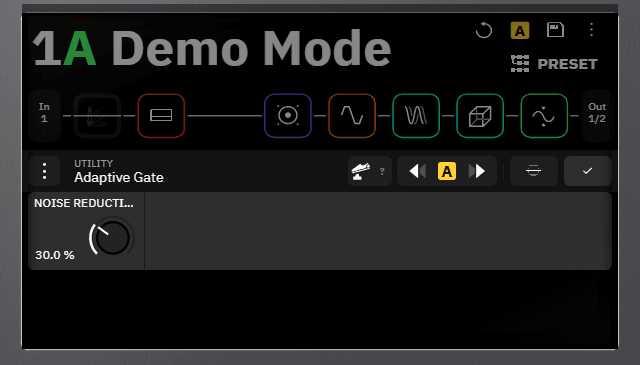
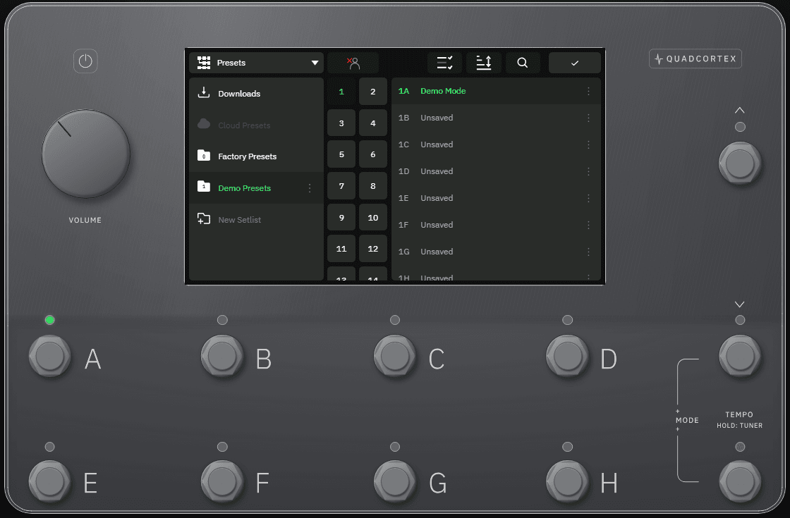
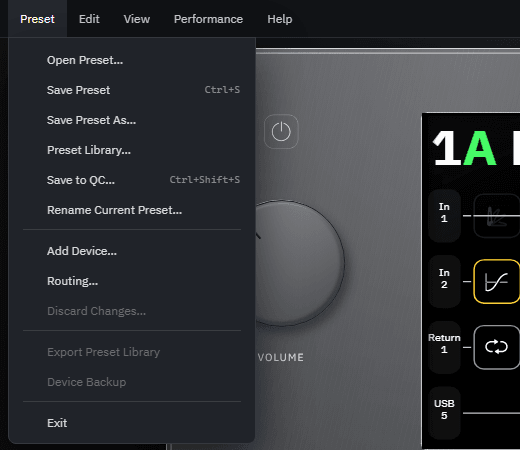
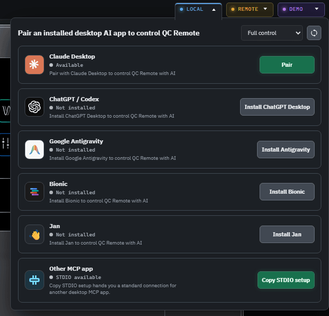
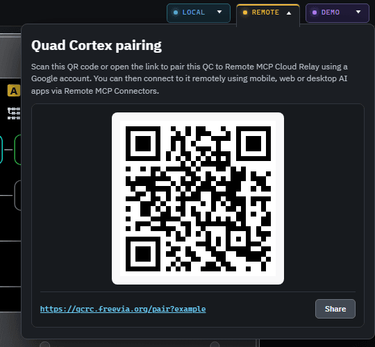

# QC Remote user guide

This guide is for people who want to use QC Remote with a Quad Cortex. It
covers installing the apps, connecting the unit, what the on-screen indicators
mean, how the access levels and safety checks work, and how to let an AI
assistant help. Building from source is covered in the
[README](../README.md#building).

The screenshots in this guide were taken in the Windows app on its **DEMO**
device, so they show no real hardware, presets or accounts. Some details, such
as the connection indicators, look different when a Quad Cortex is connected.

- [What QC Remote is, and is not](#what-qc-remote-is-and-is-not)
- [Requirements](#requirements)
- [Installing](#installing)
- [Connecting your Quad Cortex](#connecting-your-quad-cortex)
- [Reading the indicators](#reading-the-indicators)
- [What you can do in the app](#what-you-can-do-in-the-app)
- [Access levels](#access-levels)
- [How QC Remote protects your work](#how-qc-remote-protects-your-work)
- [Connecting an AI assistant](#connecting-an-ai-assistant)
- [Privacy](#privacy)
- [Troubleshooting](#troubleshooting)
- [Reporting problems](#reporting-problems)

## What QC Remote is, and is not

QC Remote is an independent, unofficial controller for the Neural DSP Quad
Cortex. It draws the unit's front panel and screen on your computer or phone,
follows whatever preset the unit has loaded, and sends your presses, turns and
edits to the unit over USB. It also lets an AI assistant read and control the
unit through the Model Context Protocol (MCP), under limits you set.

It is **not** affiliated with, authorized, sponsored, endorsed, or supported by
Neural DSP Technologies Oy, and Neural DSP has not reviewed or approved it. The
screens it draws are independent reconstructions made for interoperability, and
they may differ from the unit. It does not contain, replace, or modify Quad
Cortex firmware. Compatibility depends on the unit's firmware, and no
compatibility guarantee is made. See [`TRADEMARKS.md`](../TRADEMARKS.md) for the
full notice. For questions about the Quad Cortex itself, contact Neural DSP.

QC Remote is developed by Freevia EOOD under the licences described in
[`LICENSE`](../LICENSE).

## Requirements

| | Windows | Linux preview | Android |
| --- | --- | --- | --- |
| System | Windows 10 or 11, 64-bit | Ubuntu 24.04, x86_64 | Android 7.0 or newer (API level 24) |
| Connection to the unit | USB cable to the PC | USB cable and a one-time udev rule setup | USB host (OTG) support on the phone, plus a suitable cable or adapter |
| Hardware | A Quad Cortex, switched on and connected by USB | A Quad Cortex, switched on and connected by USB | A Quad Cortex, switched on and connected by USB |

Other things to know before you start:

- QC Remote was developed and tested with Quad Cortex firmware (CorOS) 4.1.0.
  Other firmware versions may behave differently, and no compatibility
  guarantee is made.
- **One application at a time can hold the Quad Cortex USB connection.** Close
  any other application that talks to the unit before connecting. If another
  process already holds it, QC Remote says so and connects by itself once it
  lets go (see [Troubleshooting](#troubleshooting)).
- On Android, remote access (the REMOTE route below) only starts while the
  Quad Cortex is connected and USB access has been granted.
- The relay route needs an internet connection and a Google account. Everything
  else, including controlling the unit and pairing a desktop AI app on the same
  computer, works without Freevia's servers.

## Installing

QC Remote is early, pre-1.0 software (Windows 0.1.x, Linux 0.1.x preview,
Android 0.3.x). Builds are published as GitHub releases; the
[README](../README.md#download) names the current version and links each file
directly.

- **Windows 10 or 11 (x64).** Download the installer from the
  [latest release](https://github.com/freevia-org/QC-Remote/releases/latest)
  and run it. Its file name has the form
  `QC-Remote-Windows-<version>-x64-setup.exe`.
- **Android 7.0 or newer.** Download the APK from the same page and open it on
  the phone. Its file name has the form `qc-remote-<version>.apk`. The release
  also carries a `.aab` file; that is the Android App Bundle prepared for
  Google Play, not something to install on a phone.
- **Linux preview (Ubuntu 24.04, x86_64).** Download
  [`qc-remote_0.1.185_amd64.deb`](https://github.com/freevia-org/QC-Remote/releases/download/v0.1.185/qc-remote_0.1.185_amd64.deb)
  from the [v0.1.185 prerelease](https://github.com/freevia-org/QC-Remote/releases/tag/v0.1.185),
  [verify the download](#verify-the-linux-download), then install it with
  `sudo apt install ./qc-remote_0.1.185_amd64.deb`. The
  package includes the application, resident broker/MCP host, and a udev rule.
  Before reconnecting the Quad Cortex, follow the udev activation commands in
  the [Linux preview setup](#linux-preview) section below. If the
  desktop does not provide a StatusNotifier/AppIndicator tray host, the resident
  tray controls may not be visible. Other Linux distributions are not yet
  supported by this preview.

The release page lists a SHA-256 checksum for each file. On Linux, verify a
download with `sha256sum -c SHA256SUMS`; on Windows, run
`Get-FileHash <file> -Algorithm SHA256` in PowerShell.

The Microsoft Store listing is pending, and the Google Play listing is pending
an internal-test upload, so its link may not open yet. Hardware and
installed-device acceptance are not claimed for these releases.

The Linux package is a preview and may change independently of the stable
Windows and Android releases. Only the latest released build for each platform
receives fixes; earlier builds are not supported ([`SECURITY.md`](../SECURITY.md)).

### Verify the Linux download

Linux previews from 0.1.185 include a signed GitHub build attestation, created
in the same workflow that builds the Debian package. After downloading the
package and `SHA256SUMS` from the release, verify the checksum and provenance
with the [GitHub CLI](https://cli.github.com/):

```sh
sha256sum -c SHA256SUMS
gh attestation verify qc-remote_0.1.185_amd64.deb \
  --repo freevia-org/QC-Remote \
  --signer-workflow freevia-org/QC-Remote/.github/workflows/linux-broker.yml \
  --source-ref refs/heads/master \
  --deny-self-hosted-runners
```

The attestation binds the file's digest to its repository, build workflow, and
source commit. The release also includes `linux-build-provenance.sigstore.json`
as a downloadable copy of that attestation. This is build provenance, not an
embedded Debian package signature or an APT repository signing key. Version
0.1.184 predates this verification and has checksums only.

### Linux preview

The Linux preview targets Ubuntu 24.04 x86_64. The GUI, tray resident, local
MCP HTTP endpoint, and stdio bridge share one broker process and one per-user
state directory. The app uses USB HID for device control and the matching ALSA
raw MIDI endpoint for its performance MIDI feature; it is not a USB audio
interface. Remote MCP requires the same account/network setup described below
and is separate from local MCP.

The package places its rule at `/usr/share/qc-remote/70-qc-remote.rules` but
does not activate it automatically. Install it into udev's rules directory,
reload rules, then reconnect the device:

```sh
sudo install -m 0644 /usr/share/qc-remote/70-qc-remote.rules /etc/udev/rules.d/70-qc-remote.rules
sudo udevadm control --reload-rules
```

The rule grants access only to the supported Quad Cortex USB product IDs and
uses `uaccess` for an active local desktop seat, covering HID and raw MIDI
nodes. It does not rebind kernel drivers or grant access to all HID/audio
devices. SSH-only users are not an active local seat; the broker guide documents
the optional dedicated-group alternative. If your desktop lacks a
StatusNotifier/AppIndicator host, the main window and MCP connections still
work, but the tray icon may not be shown. This preview has not been qualified
on other Linux distributions.

## Connecting your Quad Cortex

### Windows

1. Close any other application that may be connected to the Quad Cortex.
2. Connect the Quad Cortex to the PC with a USB cable and switch it on.
3. Start QC Remote. It looks for the unit by itself. If you plug the unit in
   after the app has started, it notices and connects.
4. Watch the **USB** indicator at the right end of the menu bar. It moves
   through *Connecting*, *Searching for Quad Cortex* and *Synchronizing active
   preset* before it settles on *Live and synchronized*. Reading the unit's
   library on connection can take around ten seconds.
5. Click the indicator and check that **Current preset** matches what the
   unit's own screen shows.

QC Remote opens on a **DEMO** device that exists only on your computer, so the
window is usable before a unit is found. Nothing you do on the demo device is
sent to a Quad Cortex. Use the tabs at the top of the USB panel to switch
between **Quad Cortex** and **DEMO**. Switching to DEMO while a unit is
connected leaves the unit connected in the background; **Switch to Quad
Cortex** brings it back.





### CorOS updates over USB (Windows)

A Quad Cortex that is connected to QC Remote by USB does not use its own Wi-Fi
for a CorOS update, so it asks its host to fetch the update for it. QC Remote
does this: when you press **DOWNLOAD UPDATE** on the unit, the broker carries the
unit's own update request to Neural DSP's servers over this computer's internet
connection and hands the answer back over USB. The connection is opened by QC
Remote's background component on the unit's behalf; the app itself makes no
requests of its own. QC Remote only passes the Quad Cortex's own requests
through; it forwards the unit's headers as they are (its HTTP library adds only
a `Host` header and, when the unit sent none, a generic `Accept` header) and
keeps no copy of them or of the answers. It
carries no presets, captures, backups or logs, and not the unit's Cortex Cloud
account traffic.

- The switch is **Edit > Settings… > Internet for the Quad Cortex**. It is **on by
  default**. Under it QC Remote shows what it is doing: that it is passing a
  request through, how the last request went, that it declined the last request,
  or how many times the unit asked while the switch was off. With it off, the
  unit's requests get no answer (in the capture the unit asked again about once
  a minute; what it finally does has not been observed), and turning it off ends
  a transfer that is running.
- The unit sends its own serial number and credentials to Neural DSP, exactly as
  it would over Wi-Fi, and Neural DSP sees this computer's IP address. The same
  goes for any extra domain you allow below: it receives the unit's request,
  credentials included.
- The USB link is slow for a download: a full CorOS image can take ten minutes
  or more. For a faster update, use the unit's Wi-Fi (disconnect it from the
  computer first), as the Quad Cortex manual describes. Do not run Cortex
  Control at the same time; only one application can hold the unit.
- Only `neuraldsp.com` (any path) and its subdomains are passed through, and
  any extra domain you add. If the unit asks for anything on another domain (an
  image on a content-delivery network, for example), QC Remote declines it and
  the unit's update fails. The Settings row then says that the last request was
  declined; the domain's name is in the background component's error output and
  in the device flight recorder (`%LOCALAPPDATA%\QC Remote\device-flight-recorder.json`,
  a local file), and not in the status that AI apps can read. To allow a domain, add it to `updaterRelayExtraDomains` in
  `device-broker-tray.json` in `%LOCALAPPDATA%\org.freevia.qcremote`; the change
  is picked up within a couple of seconds.
- Closing QC Remote or unplugging the unit during an update stops the transfer.
  The unit decides what that means for the update; QC Remote does not retry.

### Android

1. Connect the Quad Cortex to the phone's USB port (through an OTG adapter or
   cable if needed) and switch the unit on.
2. Open QC Remote. When the unit is attached, Android itself shows its USB
   confirmation dialog for QC Remote; allow it.
3. If you dismissed that dialog or want to retry, open the **USB** indicator at
   the top right and press **Connect**. Only a deliberate press of **Connect**
   makes the app ask for USB permission; a unit that merely appears while the
   app is open is handled by Android's own dialog, so you are not asked twice.
4. When it is connected, the indicator panel shows *Quad Cortex ready* and the
   current preset.

If no unit is found, the Android app also starts on its **DEMO** device
(preset changes stay on the phone). The panel's **Connect Quad Cortex** or
**Switch to Quad Cortex** button returns to the hardware.

If you deny the permission, the app reports "USB permission was denied."
Press **Connect** again to be asked again. If you unplug the unit while the
prompt is open, the app reports that the Quad Cortex was unplugged before USB
permission was answered.

## Reading the indicators

### Windows menu bar

Three indicators sit at the right end of the menu bar. Each one opens a panel
when clicked, and **Esc** closes it.

| Indicator | What it shows |
| --- | --- |
| **USB** | The connection to the Quad Cortex. It reads **DEMO** (violet) while the demo device is active. |
| **LOCAL** | Desktop AI apps paired with QC Remote on this computer. |
| **REMOTE** | The optional relay that lets an AI app reach your unit from elsewhere. |

The coloured light on each indicator uses the same scheme:

| Light | Meaning |
| --- | --- |
| Green | Ready. For USB, this means the app, the USB link and the preset on screen all agree with the unit. |
| Blue, pulsing | Working: connecting, synchronizing, or establishing the remote connection. |
| Grey | Idle or absent. |
| Amber | Needs an action from you (for example, "Pair again" or "Update available"). |
| Red | An error. |
| Violet | The demo device. |

**USB panel text** you may see:

| Text | Meaning |
| --- | --- |
| Searching for Quad Cortex | Nothing has answered yet. Check the cable and that the unit is switched on. |
| Connecting | The unit was found and is being opened. |
| Synchronizing active preset | The app is reading the preset the unit has loaded. |
| Live and synchronized | Connected, and the preset on screen is the unit's preset. |
| Disconnected / Offline | No session. Close other applications that use the unit, then press **Connect**. |
| No Quad Cortex found | Nothing answered. |
| Demo device on this computer · no hardware attached | The demo device is active. |
| Writes are paused until the USB session is reset. | See [Troubleshooting](#troubleshooting). |

The panel also lists the **Connection log** (with **Clear history**) and a
**Device info…** button, which opens the Device Info window with the device
name, connection state, setlist, preset, mode, scene, tempo, block count and
whether there are unsaved changes, and the Device Information screen with the serial number, name and software versions the Quad Cortex reports about itself. They are shown on this computer only and are never included in diagnostics.

**REMOTE panel states:** *Not set up* (not yet paired), *Waiting for sign-in*,
*Connecting*, *Ready* ("This host's secure outbound relay route is connected"),
*Paused* (paired, but the remote route is not connected, with a **Reconnect**
action), *Pair again* (the pairing expired or is no longer valid), and
*Unavailable*.

**LOCAL panel rows** say, for each supported AI app, whether it is installed,
paired and connected. A paired app that is not connected at this moment is
normal, because most of them start their connection when you start a chat.
Typical row states are *Connected*, *Paired · idle*, *Paired · not yet
connected*, *Not installed*, *Update available*, *Needs attention* and
*Unpaired*.

### Android header

The Android app has a **REMOTE** and a **USB** indicator at the top right (the
USB one reads **DEMO** while the demo device is active). Tapping either opens
its panel. The USB panel reads *Quad Cortex ready*, *Quad Cortex
synchronizing*, *Quad Cortex writes paused*, *Quad Cortex connection error* or
*Quad Cortex disconnected*. The Android app has no LOCAL indicator; desktop AI
apps are paired from the Windows app.

## What you can do in the app

### The on-screen Quad Cortex

The window shows a Quad Cortex: master volume, Footswitches A to H, **BANK UP**,
**BANK DOWN**, **TEMPO**, and the device screen. The lamps follow the unit.
Everything you press or turn is sent to the hardware. The on-screen power
button does nothing to the unit, so powering down and locking the screen stay on
the unit itself.

- Click a footswitch to press it in whichever mode the unit is in.
- **BANK UP** and **BANK DOWN** step to the previous and next preset.
- Click **TEMPO** to send a tap. Drag or scroll it to change the tempo from 40
  to 240 BPM.
- Drag or scroll the master volume knob.
- On the Grid screen, swipe up from the bottom edge of the screen to open
  **Gig View**, or down from the top edge to open the **I/O** view. Taps in
  those edge areas still reach the Grid control underneath.

### Grid and preset editing

- Click a block to open its live parameters; click it again to close them.

  

- **Preset > Add Device…**, **Preset > Routing…**, and **Edit > Copy Device /
  Paste Device** add, route and copy devices. Removing a block with **Delete**
  can be undone with **Ctrl+Z**.
- **Preset > Preset Library…** opens the unit's directory of presets so you can
  recall one. Recalling a preset does not ask about unsaved edits.

  

- **Preset > Rename Current Preset…** renames the stored preset.
- **Edit > Undo** and **Redo** step through the changes QC Remote made in this
  session.

### Saving

There are two different kinds of saving, both in the **Preset** menu.



- **Save to QC…** (**Ctrl+Shift+S**, or the save icon on the unit's screen)
  writes the loaded preset back to the unit. It names the slot and preset it is
  about to write.
- **Save Preset**, **Save Preset As…** and **Open Preset…** work with a local
  `.qcw` workspace file on your computer. A workspace is a reference copy; opening
  one never writes anything to the Quad Cortex.

Edits to a preset live in the unit's memory until they are saved. Recalling
another preset, reloading, or switching the unit off throws unsaved edits away.
**Preset > Discard Changes…** reloads the stored preset on purpose.

### Performance menu

**Previous Preset** and **Next Preset** (disabled while there are unsaved
edits), **Tempo…**, the unit's mode slots, **I/O Settings**, **Tuner**,
**Looper X** and **Gig View**. **Tuner** opens QC Remote's own tuner screen,
which reads and sets the unit's tuner settings. With a unit connected, QC
Remote also sends it the message that asks it to show its tuner, but on a
CorOS 4.1.0 unit that message was observed to do nothing (no tuner screen
appeared), so do not expect the unit's own screen to change; see the
[limits register](../packages/rust/quadcortex/docs/guide/11-limits.md).
**Gig View** opens in QC Remote and is requested on the unit's own screen.

### Copying, backups and the demo device

- **Edit > Copy Preset / Paste Preset** copy a whole preset into another slot,
  overwriting what was stored there.
- **Edit > Copy Preset as Text / Paste Preset from Text** use the clipboard.
- **Edit > Copy Setlist / Paste Setlist**: switch to the DEMO device before
  pasting to recreate a setlist's presets there. Neural Captures and IRs cannot
  run on the demo device, so they are reported and left out.
- **Preset > Device Backup** asks for a name and location and pulls a native
  backup off the unit, which takes around forty seconds.
- **Preset > Export Preset Library** is listed but disabled.

On Android, the demo device panel has **Copy library**, **Paste library** and
**Stop demo**.

### Keyboard (Windows)

| Keys | Action |
| --- | --- |
| F1 | Open the user guide window |
| 1 to 8 | Press Footswitches A to H |
| Ctrl+1 to 8 | Select Scenes A to H |
| [ and ] | Step a whole bank down or up |
| Arrow keys, Enter | Select the nearest Grid block, open its parameters |
| T / Shift+T | Tap tempo / open QC Remote's tuner screen |
| B | Toggle the selected block on or off |
| Ctrl+Z, Ctrl+Y | Undo, redo |
| Ctrl+S, Ctrl+Shift+S | Save workspace file, Save to QC |
| Esc | Cancel a pending edit or close the open dialog or panel |

The Grid keys pause while you are typing in a field, so naming a preset never
presses a footswitch.

### Settings and the tray (Windows)

**Edit > Settings…** holds:

- **Device model**: the hardware geometry and appearance of the on-screen
  chassis.
- **AI access level**: see [Access levels](#access-levels).
- **Internet for the Quad Cortex**: lets the Quad Cortex use this computer's
  internet connection to reach Neural DSP's servers (neuraldsp.com addresses,
  plus any extra domain you add) for updates while it is connected over USB (on
  by default); its serial number and its own credentials
  go with its requests. See [CorOS updates over
  USB](#coros-updates-over-usb-windows).
- **Show tray icon**: shows device status in the notification area and keeps
  MCP access available when the QC Remote window is closed. The tray menu
  shows the unit's status, the local MCP endpoint, a **Connect** or
  **Disconnect** action, a summary such as "2 local and 1 remote client
  active", one entry per active client and per linked remote app, a
  **Release QC after last client: …** submenu, and **Quit**. **Quit**
  releases the unit and closes the tray icon and the background MCP host;
  nothing restarts them by itself, and they return only on a user action, such
  as opening QC Remote. Remote clients are
  marked "(remote)"; several sessions of one app share an entry that says how
  many it holds. Each entry opens the client's details (kind, version, when
  it connected and, for a remote client, the route and location the relay
  saw). **Unlink** on a local AI app pauses that chat's listing while it is
  idle; it links again the next time the chat uses a QC Remote tool, so this
  is a reset, not a block. Reading QC Remote's
  resources (status, current preset, models) does not link it again. If the
  computer sleeps or QC Remote stalls for 12 seconds or more, the unlink is
  forgotten and the chat appears again on its next check-in. Unlinking the
  last local app lets QC Remote's connection to the unit go until that chat's
  next request; with **Release QC after last client** set, the unit is
  released on that setting as when any last client leaves, and reconnected by
  that next request. An AI app still running a QC Remote bridge from before
  this change cannot link again by itself: after Unlink it stays off the list
  until that app restarts its QC Remote connection (or QC Remote restarts),
  its requests keep working, but it no longer keeps the unit held. With
  **Release QC after last client** at Immediately, each of its requests after
  a pause then has to reopen the unit first and can fail with a "not
  connected, retry" error until that app restarts its QC Remote connection.
  Remote AI apps are listed as the Remote panel
  lists them: one entry per linked app (one sign-in), marked "Active now" with
  its live sessions inside, or "Linked, idle". The summary counts only active
  clients; a separate line says how many linked remote apps are idle. Until QC
  Remote Cloud is updated to say which linked app each session belongs to,
  entries read just "Linked" and active sessions are listed separately.
  **Unlink** on a remote app asks first, then ends that one authorization and
  says it is unlinked only once QC Remote Cloud no longer lists it: the app
  must sign in again before it can use QC Remote, while your other linked
  apps, your account and this computer's pairing stay as they are. Each entry
  is one sign-in, not necessarily one device: an app that keeps a single
  sign-in for all your devices appears once, and unlinking it signs all of
  them out. If the menu says the linked apps could not be loaded, it shows
  active sessions only; if it says the cloud needs an update, unlink the app
  from the Remote panel in QC Remote instead. When QC Remote cannot read its
  own client list yet, the menu says "Client list unavailable" rather than
  "No clients active".
- **Release QC after last client**: releases the unit a set number of minutes
  after the last attached app or AI client disconnects. Every attached client
  holds the unit, including an AI app (Claude, Codex, ChatGPT and others) that
  is connected but idle; the timer starts only when nothing is attached.
  Turning it off ("Never") keeps the unit connected until you choose Disconnect
  or Quit, and 0 releases it about five seconds after the last attached client
  disconnects. It needs the tray icon to be shown.

The **View** menu has **Fit to Window**, **Actual Size** and **Full Screen**.

### Android extras

The Android app has **I/O** and **GIG** buttons beside the master volume. Holding
or double-tapping **TEMPO** opens QC Remote's tuner screen or the tempo screen (which gesture
does which follows the unit's tempo and tuner access setting). Tap the QC Remote
mark to open **About**, where **Display** has a **Keep screen awake while
connected** option (on by default).

## Access levels

Both AI routes enforce the access level you choose. On Windows, set it from
the header of the LOCAL panel or in **Edit > Settings…**. It applies to every
paired assistant, local and remote. On Android, use the access selector in the
REMOTE panel. The levels build on each other, and the app starts at **Full
control**, so lower it if you want the assistant to do less.

| Level | What an assistant can do |
| --- | --- |
| **Read-only** | Inspect: current preset, block details, lists of presets, models, captures and IRs, settings, tempo, looper status and screen captures. Changes nothing. (The device diagnostics tool is also read-level, but it is not currently supported; see [Tools for assistants](#tools-for-assistants).) |
| **Performance** | Everything above, plus the performance controls: press footswitches, tap tempo, move between banks, ask the unit to show its tuner or Gig View (on a CorOS 4.1.0 unit the tuner request was observed to do nothing), select a mode slot, control Looper X, and set the master volume and tempo. |
| **Modify** | Everything above, plus editing: scenes (select, copy, label, colour), recalling or reloading a preset, blocks and parameters (add, replace, move, remove, bypass, reset, set values and assignments), captures and IRs, routing and splits, undo and redo, rename and copy the current preset, and saving a preset to a device slot. |
| **Full control** | Everything above, plus system operations: reconnecting, resetting or disconnecting the device session, device backups, the device name, on-screen taps, swipes, drags and single raw touch frames, global and I/O settings, Global EQ, tuner and tempo settings, favourites and pinned models, requesting a device model preset from a block (QC Remote sends the request and does not confirm what the unit does with it), and creating, duplicating, deleting or moving setlists and presets. |

The authoritative list of every action and the level it needs is
[`contracts/public/qc-actions.v1.json`](../contracts/public/qc-actions.v1.json).

## How QC Remote protects your work

- **Live edits are not saved edits.** Changing blocks, parameters, scenes and
  routing only changes the preset in the unit's memory until a save happens.
  Assistants are told to say so plainly after editing and to ask before saving.
- **Writes to the unit are guarded.** Adding, moving, removing, re-routing and
  re-assigning devices each ask first in the app and say that the change is
  temporary until the preset is saved. **Save to QC…**, renaming and pasting a
  preset overwrite stored data and name the slot and preset in their prompt, so
  read the name before you answer.
- **Assistants must prove they looked first.** Actions that write to the unit
  carry expected-state arguments (for example the preset's identity or the name
  expected at a slot). If the unit has changed since the assistant read it, the
  action is rejected instead of landing on the wrong target.
- **Persistent and risky actions need an explicit confirmation.** The MCP layer
  refuses these calls unless the assistant sends the matching confirmation
  field. A confirmation field alone cannot prove that a person agreed, so the
  assistant guidance tells assistants to describe the action and get your
  answer first. Deleting a preset or a setlist is the clearest case: the
  assistant must name the exact preset or setlist and its consequences in the
  AI conversation and get your explicit answer there. The Windows or Android
  app does **not** ask a second time, on either the local or the remote route,
  so your answer in the conversation is the only confirmation.
- **Device content is data, not instructions.** Preset names, scene labels and
  other text from the unit are treated as plain data by the assistant guidance.
- **Pick the lowest level that does the job.** A Read-only assistant cannot
  change anything, whatever it is asked.
- **Keep backups.** Keep independent backups of presets you would hate to lose,
  and keep output levels safe when the unit feeds an amplifier.

Deleting a preset or setlist, saving over a slot, and other library changes
take effect on the unit immediately and generally have no undo.

## Connecting an AI assistant

QC Remote offers two routes. Both enforce the [access level](#access-levels).

### On the same computer (Windows)

1. Click **LOCAL** in the menu bar. The panel is titled "Pair an installed
   desktop AI app to control QC Remote" and lists Claude Desktop, ChatGPT /
   Codex, Google Antigravity, Bionic (shown as LM Studio on older builds), Jan,
   and an **Other MCP app** row.
2. Press the row's button. **Pair** writes the connection into that
   application's own configuration, **Update** repairs a pairing that has
   drifted, and an install button opens the application's download page when
   it is missing.
3. Set the access level in the panel header before you hand an assistant
   anything.
4. Start a conversation in the assistant. Once paired and up to date, the row
   shows an **Open** button.



Claude Desktop gets a one-click extension. ChatGPT Desktop/Codex, Google
Antigravity, Bionic and Jan are configured automatically. For any other MCP
client, press **Copy STDIO setup** on the **Other MCP app** row and paste the
copied block into that application's own MCP configuration. Each automatic
route is backed up before it is replaced, and other MCP servers in that
application are left alone. Each time QC Remote starts, it also repairs its own
entry in those applications if the entry has drifted, for example after the
app was moved. Changes you made inside that entry are overwritten, and an entry
you switched off in the application is switched back on; use **Unpair** to stop
QC Remote from keeping a route there. Details of what is written where are in
[`apps/windows/README.md`](../apps/windows/README.md).

**Unpair** removes only QC Remote's own entry. For Claude Desktop, QC Remote
opens Claude's extension page with QC Remote selected, and you remove it there.

The connection stays on your computer, although the assistant itself sends
what it receives to its own provider under its own policy.

### From anywhere (Windows or Android)

1. Open the **REMOTE** indicator. On Windows, scan the QR code or open the link
   with a browser; on Android, press **Pair device**, which opens a browser
   sign-in. Sign in with your Google account. A pairing code lasts ten minutes.
2. Add `https://qcrc.freevia.org/mcp` as a custom connector in Claude or
   ChatGPT, and sign in with the same Google account. On Windows, the REMOTE
   panel shows the connector address with a **Share** button.
3. Leave QC Remote running with the unit connected. It owns the USB connection;
   the relay never speaks USB. On Android, this keeps one low-priority ongoing
   notification while remote access is active, and Android 13 or newer asks
   for notification permission first.



The Windows REMOTE panel lists the **Linked Remote MCP apps**; **Unlink**
revokes one app's authorization, and **Unpair** removes this host from the
relay. The relay
source is in [`services/qc-remote-cloud`](../services/qc-remote-cloud).

### Tools for assistants

QC Remote's MCP server publishes only the typed actions listed in the contract
above, and it includes reference knowledge about the Quad Cortex for
assistants ([`skills/qc-device-knowledge`](../skills/qc-device-knowledge/SKILL.md)).
Its built-in guidance tells an assistant to leave the unit alone for general
questions, to read the unit's status and current preset before changing
anything, and to say when a change is unsaved.

The device diagnostics tool (`get_device_diagnostics`) is not currently
supported: the Quad Cortex does not answer that request, so the call times out
after about 5 seconds and returns nothing. It is kept for possible future
firmware support.

## Privacy

What stays on your computer or phone, what the optional relay receives and
keeps and for how long, and how to delete it are stated once, in
[`PRIVACY.md`](../PRIVACY.md), which is also published at
<https://freevia.org/qcremote/privacy>. This guide does not repeat it, so it
cannot disagree with it.

## Troubleshooting

These cover messages the apps actually show.

| What you see | What to try |
| --- | --- |
| USB indicator stays grey, "Searching for Quad Cortex" or "No Quad Cortex found" | Check the cable and that the unit is on, then press **Connect** in the USB panel. |
| "Disconnected" or "Offline" | Close any other application that uses the unit, then press **Connect**. |
| "The Quad Cortex is in use by … waiting for it to let go" | Another process holds the USB connection. Close it. QC Remote connects by itself as soon as it does. |
| "Quad Cortex is not attached or is owned by another application" | Reconnect the cable and close other applications that use the unit. |
| Green indicator, but commands keep failing | **Disconnect**, then **Connect** to start a fresh device session. |
| "Writes are paused until the USB session is reset." (Android: "Quad Cortex writes paused", or "A previous write to the Quad Cortex could not be confirmed. Writes are paused until the device is reconnected.") | The app could not confirm a write and is holding further writes. For edits to the live preset the pause can clear itself when you try again after a few seconds; otherwise reconnect the unit (**Disconnect**, then **Connect** on Windows; **Reconnect** on Android). |
| A menu entry is grey | Most entries need a ready device. Some also need the loaded preset to have no unsaved edits. |
| "USB permission was denied." (Android) | Press **Connect** and allow USB access. |
| "Another copy of QC Remote is serving the AI apps on this PC." | Close the other copy, then reopen this one. |
| "QC Remote is not offering a local connection right now" | Restart QC Remote. |
| "Claude did not confirm the QC Remote extension." | Open Claude Desktop and approve the extension, or press **Pair** again. |
| REMOTE shows "Pair again" or "Paused" | Press **Pair device** to pair again, or **Reconnect** if the host is still paired. |
| Paired AI app shows "not yet connected" | Normal until you start a conversation in that app. |
| The unit's DOWNLOAD UPDATE does not complete | Check **Edit > Settings… > Internet for the Quad Cortex**: it must be on, and its status line says whether QC Remote declined the last request (see [CorOS updates over USB](#coros-updates-over-usb-windows)). |

To send diagnostics with a bug report, use **Help > Export Diagnostics…** or
**Help > Report an Issue…** on Windows. The report is redacted: it names no
serial numbers, MAC addresses, user names, file paths, or preset or setlist
names. Nothing is posted until you submit the issue form yourself.

## Reporting problems

- **Bugs and ideas:** open an issue using the
  [bug report](../.github/ISSUE_TEMPLATE/bug-report.yml) or
  [feature request](../.github/ISSUE_TEMPLATE/feature-request.yml) form on the
  [issues page](https://github.com/freevia-org/QC-Remote/issues/new/choose).
  Include the QC Remote version (shown in About), your platform and, if you
  know it, the unit's firmware version. Do not post credentials, serial
  numbers, personal data or proprietary presets.
- **Security problems:** do not use a public issue. Follow
  [`SECURITY.md`](../SECURITY.md).
- **Privacy questions:** see [`PRIVACY.md`](../PRIVACY.md).
- **Quad Cortex hardware or firmware questions:** contact Neural DSP, not this
  project.
